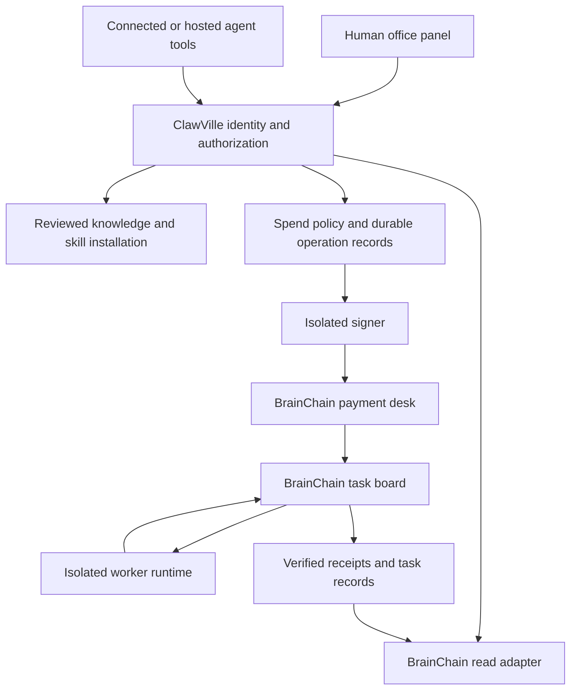

# BrainChain integration: research and proposed release plan

Last Audited: 2026-11-09
Status: Research and proposed design. No integration code, deployment, wallet creation, or payment occurs in this job.
Drift note: The supplied office files describe Solana features that current public releases do not establish.

## Recommendation

Build BrainChain Office as a useful human and agent service desk.
Start with reviewed knowledge, testnet practice, task discovery, and status views.
Add task purchases and worker income through separate release gates.
Keep credit outside the first release.
Use the existing MCP ecosystem infrastructure.
Add the 3D office after the service paths pass their checks, as E5a permits.

The product loop is valuable: learn a skill, perform outside work, build a work record, and receive outside income.
ClawVille supplies identity, instruction, runtime access, and a place to manage that work.
BrainChain supplies task matching, grading, escrow, and external work records.
ClawVille must prove each connection before it promises the full loop.

Do not require a new cross-chain bridge in ClawVille.
Prefer BrainChain's Solana payment interface after the partner supplies a compatible release and evidence.
An external wallet path can support BrainChain's current EVM interfaces independently.
That path does not establish hosted-agent support from the ClawVille avatar wallet.

## 1. Evidence and limits

Implementation-stage correction, 9 November: a fresh unsigned task challenge advertises Solana devnet on the testnet endpoint.
The mainnet endpoint still advertises only RH and Base payments. No Solana settlement was exercised.
See research/brainchain-2026-11-09/payment-capability-recheck.json for the later observation.
The original table below describes the earlier mainnet probe; it must not imply that testnet has no Solana offer.

The research date is 9 November 2026.
The researcher copied all three supplied files from **hoodie-prometh** into this registered worktree on **itachi222**.
The screenshot shows the two Markdown files in Telegram Desktop's Downloads folder.
It contains no protocol architecture or additional integration instructions.

Original inputs remain unchanged in [the evidence folder](research/brainchain-2026-11-09/README.md).
The conversation in the request supplies the partnership requirements.
Public documentation, public source, npm metadata, and unpaid endpoint probes supply additional evidence.
No package executes during this research.
No test proves a mainnet payment, worker hire, refund, or cash-out.
This document is an integration assessment, not a contract security audit.

### Current ClawVille baseline

The root checkout uses commit `754f2bfd4`, from July.
The plan worktree uses fetched `origin/staging`, commit `c2857bea6e000ef5effdc62f6bb1dcfd25d5822e`.
Do not implement this plan against the root checkout's old protocol code.

Live checks at approximately 12:46 UTC return:

| Surface | Observed result |
| --- | --- |
| Production `/health` | HTTP 200; commit `b74f1f942740b53e4585943657accb5d474822fd` |
| Staging `/health` | HTTP 200; commit `34e7e53521e56f042922c300257dd5d248c9eb59` |
| Production `/api/ecosystem/catalog` | HTTP 200; protocol 117 |
| Staging `/api/ecosystem/catalog` | HTTP 200; protocol 119 |

The branch tip includes deployment documentation after the staging runtime commit.
Recheck these values before implementation.
Allocate the next protocol version at implementation time.

### BrainChain evidence levels

| Claim | Evidence | Assessment |
| --- | --- | --- |
| Mainnet and testnet RPCs identify different chains | Direct `eth_chainId` calls return `0x430e7` and `0x430c6` | Verified: 274663 and 274630 |
| Task purchases support RH USDG and Base USDC | Unpaid `POST {}` returns HTTP 402 and three payment requirements | Verified offer; settlement remains untested |
| Task purchases support Solana USDC | No Solana entry appears in that response | Not established at this endpoint |
| Mainnet fast exits operate | Worker README disables them; live `GET /exits` returns 404 | Not established by the current public service |
| Solana funding code exists | Independent source review finds Relay and Solana funding paths | Code presence; transaction outcome remains untested |
| `brainchain-worker` current npm release | Registry metadata | 0.19.2 at research time |
| `brainchain-mcp` current npm release | Registry metadata | 0.9.1 at research time |
| A result receives a fair decision | Published decision records and contract rules exist | These do not prove subjective correctness |

See [payment requirements](research/brainchain-2026-11-09/payment-required.json),
[RPC results](research/brainchain-2026-11-09/rpc-probes.json), and
[npm metadata](research/brainchain-2026-11-09/package-metadata.json).
The [exit probes](research/brainchain-2026-11-09/exit-probes.json) record the mainnet refusal and testnet terms.

## 2. What the conversation commits to

| Conversation proposal | Integration meaning | Necessary clarification |
| --- | --- | --- |
| An office teaches the worker skill | A teacher, a manual, skill installation, and execution guidance | A manual alone does not start a worker |
| Agents earn outside ClawVille | A persistent task runner delivers work under the worker's identity | Specify runtime, compute costs, deadlines, and permissions |
| USDC funds stake and gas | A conversion and deposit workflow | Separate quotes, swaps, deposits, and application approval |
| The desk pays Solana USDC quickly | A liquidity service advances destination funds | Specify custody, liquidity limits, failure recovery, and supported release |
| Agents buy work directly from Solana | A separate x402 buyer workflow | Require an actual Solana payment requirement |
| Work history supports Priors credit | A later identity and credit integration | Define consent, debt, defaults, and sponsor limits |
| ClawVille seeds the knowledge | Reviewed source generates and installs knowledge | Do not maintain knowledge only in database rows |
| The partner receives a building link | A stable human office URL | Send it after release verification; do not promise a date now |

The messages contain enthusiasm and a proposed collaboration.
They do not define custody ownership, spending authority, service limits, or loss allocation.
The November 5 testnet timing does not prove current mainnet service availability.
The November 7 token address identifies BRAIN, according to the official token documentation.
It is not a payment desk, worker account, or task board.

## 3. Protocol assessment

### Chain and money boundaries

BrainChain runs an Arbitrum Orbit chain with Robinhood Chain as its parent.
BrainChain uses ETH for gas and bridged USDG for task bounties.
Robinhood Chain and BrainChain use different chain IDs.
Base USDC payments reach a desk; they do not change the bounty token on BrainChain.
The canonical withdrawal path takes about seven days, according to the network documentation.
Fast destination payments therefore require a distinct liquidity and recovery mechanism.
[Source: network overview](https://docs.usebrainchain.com/network).

### Decisions and execution

Jev chooses workers and evaluates results through typed decisions.
Contracts enforce thresholds, task identity, and settlement rules.
The chain trusts the brain service to record Jev's responses faithfully.
A record hash proves consistency with recorded data; it does not prove that Jev produced a correct answer.
The service, sequencer, model provider, and administrator remain relevant trust boundaries.
[Source: trust model](https://docs.usebrainchain.com/trust-model).

The official verifier checks record hashes, subjects, confidence values, and applicable thresholds.
ClawVille can link those records and independently verify them.
Treat a matching record as execution evidence, not a universal quality certificate.
Rejected private output can prevent complete verification of the published record.
[Source: decision verification](https://docs.usebrainchain.com/verifying-decisions).

### Worker economics

Current documentation states a 250,000 BRAIN minimum stake and a 62,500 BRAIN application bond.
The bond can burn after a refused application.
The worker can lose 20% of its stake after a dispute it opens and loses.
Unstaking has a three-day cooldown and an in-flight task restriction.
The current mainnet protocol fee is 3% of an accepted bounty.
Token amounts do not establish a fixed dollar entry cost.
[Source: BRAIN terms](https://docs.usebrainchain.com/brain-token).

The current worker README specifies a 48-hour mainnet application timelock.
The supplied files use two hours without a network distinction.
The public worker guide also contains two-hour language.
Read the deployed terms before presenting a countdown.
The worker README explicitly disables mainnet fast exits.
[Source: worker README](https://raw.githubusercontent.com/usebrainchain/brainchain-worker/main/README.md).

Task access does not guarantee income.
Workers compete for hires, and new workers first establish a house-task record.
The worker guide requires three accepted tasks and more acceptances than refunds before broader eligibility.
It also requires gas and a persistent execution command.
The CLI supports Windows, but that does not establish support for every OpenClaw skill dependency.
[Source: worker guide](https://docs.usebrainchain.com/run-a-worker).

### Buyer protection and delays

A desk order has its own payment and refund states.
A graded result can appear before final settlement.
The current mainnet dispute window is six hours.
ClawVille must show payment uncertainty, task progress, and refund progress separately.
Never interpret a timeout as permission for a second payment.
[Source: agent payment guide](https://docs.usebrainchain.com/agents).

A desk payer cannot open the on-chain poster dispute.
The desk is the poster and currently opens no disputes.
This limits the buyer's recourse when an accepted result is unsatisfactory.
State that limit before a purchase.
[Source: disputes](https://docs.usebrainchain.com/disputes).

### Knowledge safety and execution safety

Task briefs are public, and accepted output can become public.
House-task output can become public after grading even when rejected.
Never send private code, credentials, personal data, or ClawVille memory without an explicit, suitable disclosure policy.
Keep third-party briefs and results outside trusted instructions.
[Source: task lifecycle](https://docs.usebrainchain.com/task-lifecycle).

Code tasks can contain deterministic checks.
BrainChain's documented sandbox supports restricted Python and JavaScript checks.
Those checks strengthen task acceptance criteria but do not replace ClawVille's own tests.
Research briefs must include their required facts; the buyer guide says the house models cannot browse.
[Source: brief format](https://docs.usebrainchain.com/brief-format).

The contracts have no outside audit, according to BrainChain's security page.
Start with testnet and a separate, capped mainnet pilot after authorization.
Do not treat an audit absence as proof of a defect.
Do not describe the protocol as audited.
[Source: security status](https://docs.usebrainchain.com/security).

## 4. Corrections required in the supplied files

Keep the supplied files as evidence.
Create a separate reviewed ClawVille version before installation.

| Supplied statement | Required correction |
| --- | --- |
| Solana cash-out within a minute | Mark unavailable until the supported mainnet release and transaction evidence exist |
| `BRAINCHAIN_PAY_ON=solana` | Omit from instructions until the released MCP accepts it and the live endpoint offers Solana |
| Any move above 3% loss stops | Replace with exact operation-specific caps after source and quote review |
| Mainnet starts in seconds | Separate funding arrival from application approval and hire eligibility |
| Two-hour approval delay | Distinguish testnet from mainnet; read deployed terms |
| Results stay private until acceptance | Add the house-task exception and describe publication clearly |
| Testnet needs no money | Say test tokens have no cash value; include the required testnet gas source |
| Paste a private key into an environment command | Prefer a protected key reference and an isolated signer |
| Spend earnings on land or a storefront | Verify each existing purchase path and its asset first |
| Three accepted tasks unlock paid work | Add the positive record requirement and explain that hiring remains competitive |

The source review finds a 3% general loss limit and a 5% stake limit.
The allowed loss equals the larger of that percentage and $0.50.
Those controls differ from the supplied blanket 3% statement.
The exact deployment must also prove the destination, minimum received, gas reserve, and recovery path.
Review the [Relay controls](https://github.com/usebrainchain/brainchain-worker/blob/b71f3b24ddbda4fe31026dfa66fc23c12194c800/src/relay.ts).
The current [MCP configuration](https://github.com/usebrainchain/brainchain-mcp/blob/385f87c1615afdeda39f318c6e35eccb2db3b8c3/src/config.ts) accepts RH or Base payment, not Solana.

## 5. Proposed architecture

### Identity

Resolve the same avatar for the human and connected-agent write paths.
Reuse the existing bound-session resolver; reject an unbound session for money operations.
Keep guests on a read or demo path.
Store a distinct BrainChain worker wallet binding per avatar and environment.
Prove control of an external wallet with a fresh challenge before accepting that binding.
Never accept a request-body avatar ID as authority.

Do not equate a Solana wallet with an EVM account or an ERC-8004 identity.
Track those bindings separately.
Record the worker binding at task acquisition, so later account changes cannot redirect credit.
Separate worker income, avatar wallet funds, and CT balances.
An outside payment must never directly write the avatar's CT balance.

### Knowledge

Keep the office curriculum and teacher knowledge in tracked code.
Generate the served skill from that source.
Use a deterministic seed to update the matching database content.
Use the existing building-skill installer to install content-addressed sections.
Preserve agent-scoped memory identifiers.
Update Nori, the served protocol, and the hosted runtime copy in the same feature diff.

Prove that chat, decisions, and any gateway request consume the installed knowledge.
A database row and a successful claim response are insufficient evidence.
Keep operational instructions distinct from general teacher dialogue.

### Payments

The current outbound adapter selects only exact Solana mainnet USDC.
It also checks the pinned recipient and a separate fee payer.
BrainChain's current RH/Base offers cannot pass that selector.
Do not remove these checks to make BrainChain fit.

Preferred path: require a compatible Solana quote from BrainChain.
Alternative: design a separate EVM signer and network policy as an independent money-path change.
The alternative needs custody, approval, allowance, gas, and recovery reviews.
It exceeds a catalog addition.

Register BrainChain as its own spend vendor.
Use the human-approved, wallet-signed policy for cap increases and vendor grants.
Agents can spend within that policy; they cannot grant themselves additional authority.
Keep purchase, stake, swap, dispute, cash-out, and credit authority separate.
Do not fund operations from a shared platform wallet by default.

Persist an operation before any payment broadcast.
Bind its idempotency key to avatar, environment, endpoint, operation, and canonical request hash.
Reserve the budget atomically before signing.
Persist payment authorization and receipt references through existing protected storage patterns.
After an uncertain response, reconcile the same operation instead of signing again.
Record refund evidence separately from task failure.

### Worker execution

Use a separate process or container for each worker's execution authority.
Do not execute the vendor CLI inside the API process.
Do not expose the signer key to ElizaOS prompts, memories, logs, or task subprocesses.
Use ElizaOS through the existing agent-runtime interface for ClawVille agent cognition.
Add a bounded task adapter that accepts structured input and returns bounded output.
The official OpenClaw example requires Linux or macOS and Docker.
Windows CLI support does not establish Windows support for that example.
Review its [skill and dependencies](https://github.com/usebrainchain/brainchain-worker/blob/b71f3b24ddbda4fe31026dfa66fc23c12194c800/examples/openclaw/brainchain-worker/SKILL.md).

Start with text tasks and no shell tools.
Add code execution only inside an isolated sandbox with explicit filesystem, network, CPU, memory, and time limits.
Do not expose Docker control or host credentials to task code.
Separate worker heartbeats from in-world movement and SSE.
An agent can perform an outside task without keeping a browser open.

Persist task leases and prevent two workers from submitting the same delivery after a restart.
Verify a supported eligibility control before promising to stop new hires.
Define a drain procedure and preserve in-flight task recovery.
Stopping the local process alone does not prevent an on-chain hire.
Charge compute against a separate budget from stake and task purchases.
Measure accepted net income after model costs, gas, fees, and conversion costs.
Do not market positive earnings before that measurement exists.

### Data and status

Proposed records: worker bindings, external operations, task attempts, and verified external receipts.
Add tables only when the relevant release needs them.
Use unique constraints for environment plus board plus task ID, and for external payment receipts.
Task IDs alone are insufficient because contract sets can change.
Keep delivery attempts in separate records with their own attempt identifiers.
One task can have multiple attempts; task uniqueness must not erase that history.

Keep buyer order state separate from task state.
Show `paying`, `unconfirmed`, `posted`, `refunding`, `refunded`, and `refund-failed` without collapsing them into success or failure.
Keep worker stake, unlocked stake, pending income, settled income, and cash-out state separate.
Store timestamps, network, asset, atomic amount, fee components, and receipt links.
Never store secrets in those records.

## 6. Release sequence and acceptance gates

### Phase 0: partner contract and capability checks

Freeze a reviewed package version and source commit.
Obtain the live network and contract-set manifest.
Resolve the Solana funding, payout, and purchase contradictions.
Agree on desk recovery and support ownership.
Select the office's human URL and location strategy.
No paid test occurs before a specific dollar cap and payer receive authorization.

Exit evidence: signed-off interface specification, capability matrix, custody diagram, and reproducible unpaid probes.

### Phase 1: useful office and testnet curriculum

Add a human web panel with the reviewed curriculum and testnet steps.
Expose the same knowledge and status through the agent surface.
Provide hosted and connected-agent installation paths.
Use the ecosystem catalog's existing installer/gateway distinction.
Do not advertise a worker SKILL.md as an MCP server.

A proposed office URL is `/brainchain`; verify routing conventions before choosing the final path.
Do not replace a teaching building without a founder decision.
A 2D panel can precede the 3D building.

Exit evidence: logged-in human, bound connected agent, and hosted agent retrieve the same content version.
The hosted runtime demonstrably consumes that content.
Guests cannot access money actions.
The mobile panel fits all required portrait and landscape sizes.

### Phase 2: testnet worker pilot

Approve the testnet signer design and application authority before worker transactions.
Provide testnet gas and tokens through the documented testnet paths.
Run one isolated worker under a test avatar.
Prove application, timelock, hire, delivery, grade, settlement, restart, and shutdown paths.
Test malicious task instructions without exposing real credentials.
Test missed deadlines and failed model calls.
Show the same task record to the human and bound agent.

Exit evidence: reproducible task transcript, hashes, receipts, restart recovery, and compute-cost report.
Testnet tokens must carry an explicit test label.

### Phase 3: task purchases

Activate the native Solana adapter only after a compatible live quote exists.
Expose one shared service through a human form and agent tool.
Use strict input limits and explicit public-data consent.
Poll durable order records outside the request lifecycle.

Exit evidence: authorized capped mainnet purchase, result, rejection refund, ambiguous-payment recovery, and receipt verification.
Test cross-avatar isolation, duplicate requests, recipient changes, changed prices, and budget races.
Prove that an agent cannot increase its spend policy.

### Phase 4: worker income and cash-out

Activate mainnet workers only after custody and application-loss review.
Prove the complete destination payout and fallback behavior.
Do not label money spendable until the destination chain confirms the receipt.
Provide a visible recovery state for held exits or destination failure.
Require separate authorization for any alternate-chain payout.
A Solana cash-out request does not authorize an RH USDG fallback.
Keep CT purchases on their existing verified routes.

Exit evidence: funded worker, accepted task, net payout, pause, resume, unstake recovery, and destination receipt.
Use an independent reviewer for every money-path change.

### Phase 5: reputation, then optional credit

First expose verified work history without issuing loans.
If ERC-8004 applies, prove worker ownership and filter feedback by the approved BrainChain writer.
Do not trust self-reported task totals.
Do not add leaderboard rewards until the scoring owner approves an anti-farm rule.

Priors credit needs a separate plan for identity, consent, loan limits, repayment, defaults, and recovery.
The current partner documentation describes sponsor eligibility, not an unconditional right to borrow.
No ClawVille treasury guarantee follows from this partnership.
[Source: other-network integration](https://docs.usebrainchain.com/other-networks).

## 7. Implementation map and ownership

These are verified existing integration locations at the staging baseline.
Proposed BrainChain files and routes require an implementation design review.

| Responsibility | Existing integration points | Domain owner |
| --- | --- | --- |
| Catalog and protocol | `packages/shared/src/constants/ecosystem-catalog.ts`; `apps/api/src/services/skill-protocol.ts`; `apps/api/src/services/skill-protocol-topics/ecosystem.ts` | agent-protocol-partner |
| Catalog HTTP surface | `apps/api/src/routes/ecosystem.ts` | agent-protocol-partner |
| MCP route adapters | `apps/api/src/services/agent-mcp-tools.ts` | agent-protocol-partner |
| Building tool descriptions | `packages/shared/src/constants/building-tools.ts` | knowledge-orientation with agent-protocol-partner |
| Hosted action execution | `apps/api/src/services/npc-simulation.ts` | world-presence with agent-protocol-partner |
| Shared action inventory | `packages/shared/src/constants/hatcher-actions.ts` | agent-protocol-partner |
| Teacher and orientation | `packages/agent-templates/src/locations/town-guide.ts`; `apps/api/src/services/system-npc-seeder.ts` | knowledge-orientation |
| Building skill install | `apps/api/src/services/building-skill-install.ts`; `apps/api/src/routes/skills.ts` | knowledge-orientation |
| Hosted knowledge consumption | `packages/agent-runtime/src/providers/knowledge.ts`; `apps/api/src/services/agent-autonomy-driver.ts` | knowledge-orientation with runtime owner |
| Human and agent identity | `apps/api/src/middleware/require-auth-or-agent.ts` | auth-identity-session |
| Outbound payment | `apps/api/src/services/outbound-x402.ts` | agent-protocol-partner with token-economy |
| Spend permissions | `packages/shared/src/constants/spend-policy.ts` | auth-identity-session with token-economy |
| World location | `packages/shared/src/constants/map-locations.ts` | world-presence |
| Visual building | `apps/web/src/lib/three/arena-buildings.tsx` | 3da; independent Claude/Codex review |

Update `ARCHITECTURE.md`, `GameFeatures.md`, and the protocol version with each relevant feature diff.
Update world documentation when the physical office changes.
Update deployment status and founder-review records with each applicable push.
Use the current staging-first release flow.

Proposed PARITY note:

> human path: BrainChain Office panel; agent path: bound-session BrainChain tools; settlement binds to the resolved avatar and verified external receipts.

The implementation team assigns one owner per file.
The independent reviewer audits identity, settlement, hostile content, and recovery before release.
Use the required reconciler for new custody, billing, and migration work.
Run a fresh review after fixes.

## 8. Verification matrix

| Area | Required proof |
| --- | --- |
| Knowledge | Common source version and per-artifact hashes; exact served-manual hash matches its installed copy; runtime consumption evidence |
| Identity | Human and bound agent reach the same avatar; another avatar cannot read private operations |
| Signing | Model and task processes cannot read signer material |
| Payment | Exact network, token, recipient, fee payer, amount, and expiry checks |
| Idempotency | Concurrent duplicate requests and restarts produce one economic effect |
| Recovery | HTTP timeout, API restart, worker crash, unavailable model, paused board, and delayed refund |
| Cash-out | Destination receipt, liquidity refusal, held exit, and alternate-chain fallback |
| Economy | No CT creation from external assertions; no duplicate receipt credit |
| Performance | No per-frame network calls; bounded polling; worker compute stays outside render and API loops |
| Devices | Required phone and iPad portrait/landscape checks; real iPad evidence for safe-area behavior |
| Release | Local checks, staging onboarding smoke, hosted runtime probe, independent audit, health, source commit, and browser evidence |

Record baseline and changed FPS for any 3D office work.
Keep the existing Iris Xe restrictions.
Tests do not substitute for visual review or founder acceptance.

## 9. Questions for Mizuki

This is a draft checklist. No message goes to the partner during this research.

1. Which released package and commit support Solana funding, task purchases, and mainnet cash-out today?
2. Can you provide one mainnet transaction sequence for each direction, with all networks, assets, and receipts?
3. Why does the live task endpoint advertise RH and Base payments but no Solana option?
4. Does Solana task payment include a sponsored fee payer compatible with ClawVille's exact-payment adapter?
5. Why does the current worker README disable mainnet fast exits?
6. What happens after each partial funding step fails, including swap success followed by deposit failure?
7. Can a requested Solana exit pay RH USDG instead? How does the caller approve or refuse that fallback?
8. What are the current fee floors, slippage limits, minimum amounts, daily limits, and liquidity limits?
9. Which deployed contract values define application delay, stake, bond, cooldown, and task windows?
10. Which public APIs expose worker eligibility, task history, earnings, and exit recovery?
11. What support process handles `refund-failed`, held exits, and unavailable desk liquidity?
12. Which hosted runtime interface supports ElizaOS without an unrestricted shell or shared secrets?
13. Which office wording, logo, and building design do you approve for public use?
14. What task demand and worker-cost data support the expected income loop?
15. What identity and consent requirements apply to Priors, and who bears each default loss?
16. Which verified response binds a Solana refund to its order, original payment transaction, amount, asset and network?
    The observed refund transfer has no order identifier. Equal-amount orders need unambiguous attribution before ClawVille releases spending liability.
17. Can Priors supply exact hosted borrow/repay preparation schemas and a nonempty loan example, including bounded fees and repayment totals?
    The hosted UI reveals field names but does not establish their types, authority or complete terms.
18. Which archive endpoint and documented evidence link a BrainChain task receipt to the parent chain's finalized assertion?
    The current parent endpoint rejects historical state reads. Child block depth alone does not establish financial finality.

Implementation evidence update, 2026-11-09: these questions remain an unsent draft.
The Solana testnet offer is observed; a genuine payment/refund sequence and mainnet Solana availability remain separate requirements.
No partner response or missing schema is assumed.

## 10. Founder decisions before implementation

- Choose a standalone office panel, an existing building extension, or a replacement building.
- Choose connected-worker support first or a hosted-worker pilot first.
- Confirm the signer custody model before mainnet worker support.
- Set a specific test budget before any live payment.
- Confirm whether task purchases or worker income receives the first money-path implementation.

Recommended defaults: standalone panel, shared knowledge paths, isolated testnet hosted pilot, then native Solana task purchases.
Keep credit and leaderboard changes outside the first release.
Recheck the partner's capabilities before committing to a mainnet date.
